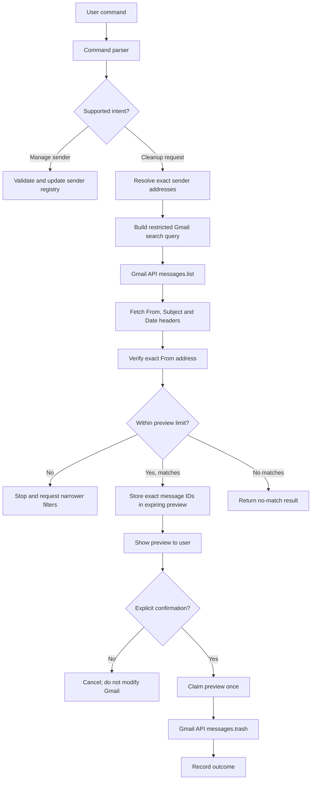

# Gmail Cleaner Agent

A local-first, confirmation-based AI assistant that finds Gmail messages by sender and moves selected messages to **Trash** only after you approve a preview.

> **Safety by design:** the first version does not permanently delete email. The AI model can interpret a command, but it cannot access Gmail or execute Gmail operations. Python validates the sender addresses, performs the search, stores the exact matching message IDs in a short-lived preview, and requires a separate confirmation request before moving those IDs to Trash.


## What it does

- Understands natural-language cleanup commands.
- Searches Gmail using exact sender addresses and optional date filters. Unsupported extra filters (for example unread-only, Inbox-only, attachment, label, subject, or keyword filters) are rejected rather than silently ignored.
- Starts with a configurable sender directory containing Facebook, Infosys Springboard, and Zoom.
- Lets you add, list, and remove senders.
- Shows the subject, sender, and date for each match before any action is taken.
- Requires a second, explicit confirmation to move the reviewed messages to Gmail Trash.
- Expires previews after a configurable period and prevents a preview from being used twice.
- Limits each preview to 200 messages by default; large searches must be narrowed with a date filter.
- Offers both a terminal interface and a REST API for a future web chat interface.
- Uses OpenAI for natural-language interpretation when configured; a deterministic local parser is used when no API key is set or the model is unavailable.

## Initial sender directory

| Display name | Exact sender address |
|---|---|
| Facebook | `security@facebookmail.com` |
| Infosys Springboard | `springboard@infosys.com` |
| Zoom | `no-reply@zoom.us` |

These are starter rules, not hardcoded restrictions. You can add or remove entries at any time.

## How the pipeline works



1. The parser translates the user's words into a small, typed command. It cannot create arbitrary Gmail search expressions or call tools.
2. The application resolves every requested sender against the saved sender directory. An unsaved sender is accepted only when its exact email address appears in the user's original command.
3. The Gmail query is assembled by application code from validated sender addresses and date filters.
4. Gmail returns message IDs. The application requests only the `From`, `Subject`, and `Date` headers, then checks that the parsed `From` address exactly matches one of the requested addresses.
5. The exact message IDs and preview details are stored locally with an expiry time. Nothing is changed yet.
6. A separate confirmation call claims the preview once and moves only those stored IDs to Trash.

## Technology stack

| Layer | Technology |
|---|---|
| Language | Python 3.11+ |
| Natural-language parsing | OpenAI Responses API with Structured Outputs (optional) |
| Fallback parser | Python rules and regular expressions |
| Gmail integration | Google Gmail API v1 |
| Authentication | Google OAuth 2.0 Desktop application flow |
| Backend | FastAPI |
| Local database | SQLite |
| Validation | Pydantic |
| Tests | pytest |

## Project structure

```text
gmail-cleaner-agent/
├── .github/
│   └── workflows/
│       └── ci.yml                 # Tests and linting on GitHub Actions
├── credentials/
│   └── .gitkeep                  # OAuth files go here; secrets are ignored by Git
├── data/
│   └── .gitkeep                  # Local SQLite database is created here
├── docs/
│   ├── architecture.md           # Design and request flow
│   └── api-examples.md           # API examples
├── src/
│   └── gmail_cleaner/
│       ├── __init__.py
│       ├── api.py                # FastAPI routes
│       ├── cli.py                # Terminal interface
│       ├── command_parser.py     # AI parser and rule-based fallback
│       ├── config.py             # Environment configuration
│       ├── database.py           # SQLite persistence
│       ├── gmail_client.py       # Google OAuth and Gmail API methods
│       ├── main.py               # ASGI entry point
│       ├── models.py             # Pydantic models
│       ├── senders.py             # Sender validation and resolution
│       └── service.py             # Application workflow and confirmation logic
├── tests/
│   ├── test_command_parser.py
│   ├── test_gmail_query.py
│   └── test_service.py
├── .env.example
├── .gitignore
├── LICENSE
├── README.md
├── pyproject.toml
├── requirements.txt
└── requirements-dev.txt
```

## Prerequisites

- Python 3.11 or later.
- A Google account with Gmail.
- A Google Cloud project where the Gmail API can be enabled.
- An OpenAI API key only if you want model-based command interpretation. The rule-based parser works without it.
- Git, if you want to push the project to GitHub.

## 1. Clone or create the repository

To use the generated project archive, extract it first, then open a terminal inside the `gmail-cleaner-agent` directory.

```bash
git init
git branch -M main
```

## 2. Create and activate a virtual environment

### Windows PowerShell

```powershell
py -3 -m venv .venv
.\.venv\Scripts\Activate.ps1
python -m pip install --upgrade pip
pip install -e ".[dev]"
```

If PowerShell blocks activation, use Command Prompt instead:

```bat
.venv\Scripts\activate.bat
```

### macOS / Linux

```bash
python3 -m venv .venv
source .venv/bin/activate
python -m pip install --upgrade pip
pip install -e ".[dev]"
```

## 3. Configure environment variables

Copy the example file:

**Windows PowerShell**

```powershell
Copy-Item .env.example .env
```

**macOS / Linux**

```bash
cp .env.example .env
```

Open `.env`. Add an OpenAI key only if you want the optional AI parser:

```dotenv
OPENAI_API_KEY=your_api_key_here
OPENAI_MODEL=gpt-5.5
```

Do not commit `.env`. It is excluded by `.gitignore`.

## 4. Configure Google Gmail API and OAuth

The agent uses Google's official Gmail API, not browser automation. Gmail search covers matching messages across the mailbox (including archived mail), while Spam and Trash are excluded. This initial version does not support an Inbox-only filter.

1. Open the [Google Cloud Console](https://console.cloud.google.com/).
2. Create a project or select a project you control.
3. Enable **Gmail API** for that project.
4. Configure the OAuth consent screen / Google Auth Platform. Add your own Google account as a test user while the application is in Testing mode.
5. Create an OAuth client ID. Select **Desktop app** as the application type.
6. Download the OAuth client JSON file.
7. Put the downloaded file at:

   ```text
   credentials/client_secret.json
   ```

8. Check `.env` and make sure `GOOGLE_CLIENT_SECRET_FILE` points to that file.
9. Run the authentication command:

   ```bash
   gmail-cleaner auth
   ```

10. A browser window opens. Sign in to the Google account you want this agent to manage and grant the requested Gmail permission. The local token is saved as `credentials/token.json`.

**Important OAuth note:** Google documents that refresh tokens for an External OAuth app left in Testing status generally expire after seven days when non-basic scopes such as Gmail scopes are requested. You may need to repeat authorization during development. Review Google's current OAuth publishing and verification requirements before changing the app to Production or distributing it to other users. Do not use another person's OAuth client or token.

Google documentation:

- [Gmail API Python quickstart](https://developers.google.com/workspace/gmail/api/quickstart/python)
- [Gmail API scopes](https://developers.google.com/workspace/gmail/api/auth/scopes)
- [Google OAuth 2.0 refresh-token behavior](https://developers.google.com/identity/protocols/oauth2#expiration)

## 5. Run the CLI

List the preloaded senders:

```bash
gmail-cleaner senders
```

Start an interactive session:

```bash
gmail-cleaner
```

Try these commands:

```text
preview emails from Facebook
preview emails from Zoom and Infosys Springboard
delete emails from Facebook older than 90 days
preview emails from Zoom before 2025-01-01
add sender LinkedIn notifications@linkedin.com
remove sender LinkedIn from my sender list
list my senders
help
```

A cleanup command always returns a preview. Review the subjects, sender addresses and dates. To proceed, type the exact word `TRASH` at the confirmation prompt. Any other response cancels the operation.

You can also provide a one-shot command:

```bash
gmail-cleaner command "preview emails from Facebook older than 90 days"
```

## 6. Run the REST API

Start the API bound to localhost:

```bash
uvicorn gmail_cleaner.main:app --app-dir src --host 127.0.0.1 --port 8000 --reload
```

Open the interactive API documentation at [http://127.0.0.1:8000/docs](http://127.0.0.1:8000/docs).

The API is intended for local development. Do not bind it to `0.0.0.0` or expose it to the internet without adding authentication, HTTPS, deployment hardening, and an explicit user-facing confirmation interface. You can configure `API_BEARER_TOKEN` in `.env` to protect API routes with a bearer token. Keep the token private.

### Preview a cleanup request

```bash
curl -X POST "http://127.0.0.1:8000/api/v1/commands" \
  -H "Content-Type: application/json" \
  -d '{"command":"preview emails from Facebook and Zoom older than 90 days"}'
```

The response includes a `preview_id`, exact `gmail_query`, matching message metadata, and `expires_at`. It does not move messages.

### Confirm a preview

Only after reviewing the returned messages, send a separate confirmation request using the returned preview ID:

```bash
curl -X POST "http://127.0.0.1:8000/api/v1/actions/confirm" \
  -H "Content-Type: application/json" \
  -d '{"preview_id":"PASTE_PREVIEW_ID_HERE","confirm":true}'
```

To cancel instead:

```json
{"preview_id":"PASTE_PREVIEW_ID_HERE","confirm":false}
```

### Manage saved senders

Add a sender:

```bash
curl -X POST "http://127.0.0.1:8000/api/v1/senders" \
  -H "Content-Type: application/json" \
  -d '{"name":"LinkedIn","email":"notifications@linkedin.com"}'
```

List senders:

```bash
curl "http://127.0.0.1:8000/api/v1/senders"
```

Remove by exact saved name or email (URL-encode special characters where necessary):

```bash
curl -X DELETE "http://127.0.0.1:8000/api/v1/senders/LinkedIn"
```

## Configuration reference

| Variable | Default | Description |
|---|---|---|
| `OPENAI_API_KEY` | unset | Optional OpenAI API key. Without it, local rules parse commands. |
| `OPENAI_MODEL` | `gpt-5.5` | Model used only for command interpretation. |
| `GOOGLE_CLIENT_SECRET_FILE` | `credentials/client_secret.json` | Google Desktop OAuth client JSON. |
| `GOOGLE_TOKEN_FILE` | `credentials/token.json` | Local OAuth token; never commit it. |
| `DATABASE_PATH` | `data/gmail_cleaner.sqlite3` | SQLite database for senders and previews. |
| `MAX_MESSAGES_PER_PREVIEW` | `200` | Maximum messages in one preview; allowed range 1–1000. |
| `PREVIEW_TTL_MINUTES` | `15` | How long a preview can be confirmed; allowed range 1–120. |
| `API_BEARER_TOKEN` | unset | Optional bearer token for API routes. |

## Gmail permissions and data handling

The app requests only this OAuth scope:

```text
https://www.googleapis.com/auth/gmail.modify
```

This scope is used to list matching messages, read selected message headers, and move confirmed messages to Trash. Google classifies `gmail.modify` as a restricted Gmail scope, so review Google's current consent-screen, verification and security-assessment requirements before distributing the app to anyone else. The code does not call Gmail's permanent-delete endpoint and does not request the broader `https://mail.google.com/` scope; Google's permanent `messages.delete` operation requires that broader scope, while `messages.trash` supports `gmail.modify`.

The command parser receives the user's command and the saved sender directory. When `OPENAI_API_KEY` is configured, that command and sender directory (including saved sender addresses) are sent to the OpenAI API for intent interpretation. Remove the key to use only the local rule-based parser. The parser does **not** receive email bodies, attachments, subjects, or full conversations. Gmail retrieval requests only the `From`, `Subject`, and `Date` headers needed for the preview. Those preview details and message IDs are stored in the local SQLite database until the database is removed. Treat the database, OAuth token and OAuth client file as private.

Gmail API reference:

- [List messages](https://developers.google.com/workspace/gmail/api/reference/rest/v1/users.messages/list)
- [Get message](https://developers.google.com/workspace/gmail/api/reference/rest/v1/users.messages/get)
- [Move message to Trash](https://developers.google.com/workspace/gmail/api/reference/rest/v1/users.messages/trash)

## Run tests and lint

```bash
pytest
ruff check src tests
```

Tests use fake Gmail clients and do not require Gmail credentials or make network calls.

## First Git commit and push

After you have extracted the repository and run the tests:

```bash
git init
git add .
git status
git commit -m "Initial commit: Gmail Cleaner Agent v0.1.0"
git branch -M main
```

Create an empty repository on GitHub, for example `gmail-cleaner-agent`. Do not initialize the GitHub repository with a README or license because those files already exist in this project. Then connect and push:

```bash
git remote add origin https://github.com/YOUR_GITHUB_USERNAME/gmail-cleaner-agent.git
git push -u origin main
```

Before committing, check `git status` and confirm that `.env`, `credentials/client_secret.json`, `credentials/token.json`, and `data/gmail_cleaner.sqlite3` are **not** staged.

## Current scope and planned improvements

### Included in v0.1.0

- Sender registry with the three initial examples.
- Exact sender-address validation.
- Natural-language parser with optional OpenAI Structured Outputs.
- Gmail search with sender and date filters.
- Message metadata preview and message-count safety limit.
- Expiring, single-use confirmation workflow.
- Trash-only Gmail operation.
- CLI, FastAPI endpoints, SQLite storage and automated tests.

### Not included yet

- Permanent deletion.
- Automatic background cleanup or scheduled jobs.
- A graphical chat frontend.
- Unsubscribe automation.
- Multi-user accounts, role management or production deployment hardening.
- Thread-level bulk deletion. This version acts on individual message IDs returned by Gmail search.

## Contributing

Issues and pull requests are welcome. Keep Gmail credentials, tokens, mailbox content, and personal data out of commits and test fixtures. Add tests for any change that can affect message selection or confirmation behavior.

## License

MIT. See [LICENSE](LICENSE).
